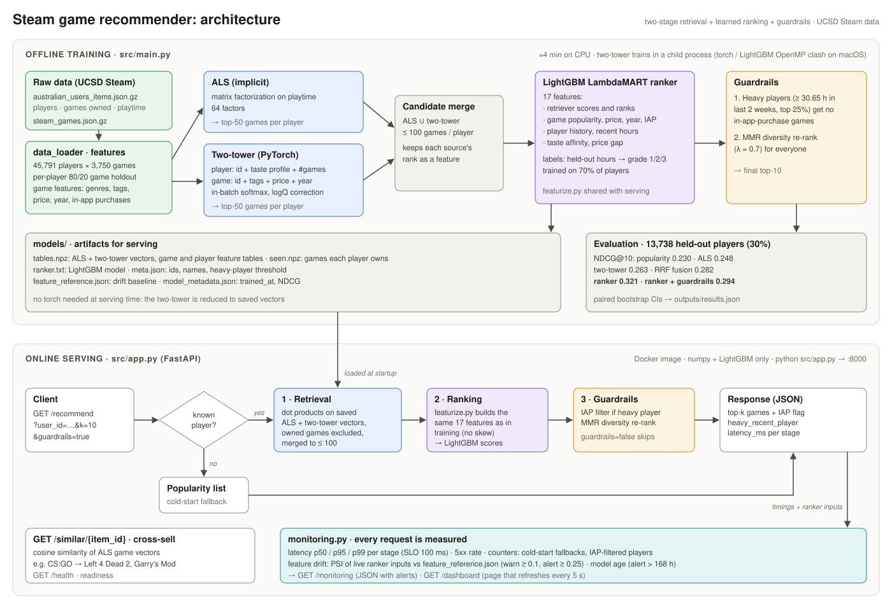

# UCSD Steam: Retrieval, Ranking, Guardrails and Serving

Personalization stack on the real UCSD Steam data (`australian_users_items`, `steam_games`).



```
ALS (collaborative filtering) ─┐
                               ├─ merge ─ LightGBM LambdaMART ranker ─ guardrails ─ top-10  ── FastAPI
Two-tower (PyTorch) ───────────┘
```

| Part | File | Library |
|---|---|---|
| Collaborative filtering (confidence = 1 + 8 x log1p(hours)) | `src/cf_als.py` | `implicit` |
| Two-tower, logQ-corrected in-batch softmax, leakage-free taste profile | `src/two_tower.py` | PyTorch |
| Candidate merge + dot-product retrieval | `src/retrieval.py` | numpy |
| Shared feature code (training and serving) | `src/featurize.py` | numpy |
| LambdaMART re-ranker, graded labels by hours played | `src/ranker.py` | LightGBM |
| Guardrails (no in-app-purchase games for intense recent players, diversity re-rank) | `src/guardrails.py` | numpy |
| Metrics + paired bootstrap | `src/evaluate.py` | `ranx` |
| API | `src/app.py`, `Dockerfile` | FastAPI |
| Monitoring: latency percentiles, feature drift (PSI), model age, alerts | `src/monitoring.py`, `src/dashboard.html` | numpy |

## Getting started

Requires Python 3.11+ (training last tested with Python 3.13 on macOS, Apple Silicon). No GPU needed.

### 1. Clone the repo
```bash
git clone https://github.com/arumds/game_recommender.git
cd game_recommender
```

### 2. Create an environment and install dependencies
Pick one of the options below. All of them install the same packages from `requirements.txt`.

**Option A: venv** (built into Python, nothing extra to install)
```bash
python3 -m venv .venv
source .venv/bin/activate            # Windows: .venv\Scripts\activate
pip install --upgrade pip
pip install -r requirements.txt
```

**Option B: conda / Anaconda / Miniconda**
```bash
conda create -n steam-recsys python=3.11 -y
conda activate steam-recsys
pip install -r requirements.txt
```

**Option C: uv** (much faster installs; get it with `brew install uv` or `pip install uv`)
```bash
uv venv --python 3.11
source .venv/bin/activate            # Windows: .venv\Scripts\activate
uv pip install -r requirements.txt
```

**Serving only** (no training, so no torch or implicit): install `requirements-serve.txt` instead.
This is what the Docker image uses. `models/` must already exist, copied from a machine that ran training.

On macOS, LightGBM also needs OpenMP: `brew install libomp`.

**In PyCharm / VS Code:** point the project interpreter at the environment you created
(`.venv/bin/python`, or the conda env `steam-recsys`). The scripts resolve paths from the project root,
so the run configuration's working directory doesn't matter.

### 3. Download the data
The data is not in the repo. Download the two files of the
[UCSD Steam dataset](https://cseweb.ucsd.edu/~jmcauley/datasets.html#steam_data) (Version 1: Australian users) into `data/`:
```bash
mkdir -p data
curl -L -o data/australian_users_items.json.gz https://mcauleylab.ucsd.edu/public_datasets/data/steam/australian_users_items.json.gz
curl -L -o data/steam_games.json.gz            https://mcauleylab.ucsd.edu/public_datasets/data/steam/steam_games.json.gz
```
(74 MB and 2.7 MB.)

### 4. Train and evaluate
```bash
python src/main.py
```
Takes about 4-7 minutes on a laptop CPU. The first run also caches the parsed data in `data/processed/`, which
saves about 100 s on later runs. It prints the results table, then writes:
- `models/`: everything the API needs (vectors, feature tables, ranker, drift baseline, model metadata)
- `outputs/results.json`: metrics, bootstrap intervals, guardrail impact, feature importance

Paths are resolved from the project root, so this works from any working directory (including an IDE run
configuration). Set `STEAM_DATA_DIR` or `MODELS_DIR` to use other locations.

### 5. Start the API
```bash
python src/app.py
```
Then open:
- http://127.0.0.1:8000/docs: interactive API docs (try `/recommend` and `/similar` here)
- http://127.0.0.1:8000/dashboard: live monitoring (latency, feature drift, model age, alerts)

Example requests (player and game ids are in `models/meta.json`):
```bash
curl "http://127.0.0.1:8000/recommend?user_id=<steam_user_id>&k=10"
curl "http://127.0.0.1:8000/recommend?user_id=<steam_user_id>&k=10&guardrails=false"   # compare without guardrails
curl "http://127.0.0.1:8000/recommend?user_id=someone-new"                             # cold start: popularity list
curl "http://127.0.0.1:8000/similar/730?k=5"                                           # games similar to CS:GO
curl "http://127.0.0.1:8000/monitoring"
```

### 6. (Optional) Smoke test
Runs the API in-process and checks every endpoint, including that heavy players never get in-app-purchase games:
```bash
pip install httpx2                   # needed by FastAPI's test client
python scripts/smoke_test_api.py
```

### Docker (serving only)
Train first so `models/` exists, then:
```bash
docker build -t steam-reco-api .
docker run -p 8000:8000 -v "$(pwd)/models:/app/models" steam-reco-api
```
The image installs only `requirements-serve.txt` (no torch). It has not been built in the authoring environment yet.

### Troubleshooting
- `FileNotFoundError: data/...json.gz`: step 3 was skipped, or the files are not directly inside `data/`.
- `Missing trained model artifact(s)` when starting the API: run `python src/main.py` first.
- Crash (`SIGSEGV`) or `OMP: Error #15` on macOS: torch and LightGBM each load their own OpenMP runtime. `main.py`
  avoids this by training the two-tower in a separate process (`src/two_tower_proc.py`); don't import torch
  anywhere else in the main process.

## Data facts and choices (checked on the real files)
- 88,310 lines but 70,912 distinct players: duplicate lines are merged (max playtime per player+game).
- 36% of owned games were never played, so **a positive is playtime >= 120 minutes**.
- Kept players with >= 10 positives and games with >= 20 positives: 45,791 players, 3,750 games, 1.82M positives.
- **No timestamps**, so a random 20% of each player's positives is held out instead of a time split. Numbers are
  more optimistic than a time split would give.
- Players are split 70/30: the ranker trains on the first group, all results below are on the other 13,738 players.
- User and item statistics (popularity, taste profile, mean price) come from training positives only.
- Known leak, small: `user_recent_h` sums last-two-weeks playtime over all games, including held-out ones.

## Results (one run, seed 0; top-10, 13,738 held-out players; `outputs/results.json`)
| Model | Recall@10 | NDCG@10 | MAP@10 |
|---|---|---|---|
| Popularity | 0.207 | 0.230 | 0.119 |
| ALS | 0.247 | 0.248 | 0.129 |
| Two-tower | 0.246 | 0.259 | 0.130 |
| Rank fusion of ALS + two-tower (no learning) | 0.266 | 0.278 | 0.144 |
| **LightGBM ranker** | **0.293** | **0.321** | **0.175** |
| Ranker + guardrails | 0.274 | 0.293 | 0.152 |

Paired bootstrap on per-user NDCG@10 (95% CI): ranker beats ALS by +0.073 [+0.070, +0.075], the two-tower by
+0.062, and the non-learned fusion by +0.042 [+0.040, +0.044]. Candidate-set recall is 0.61, the ceiling for any ranker.
Guardrails cost 0.027 NDCG (CI excludes zero), cut in-app-purchase games in intense players' lists from 22.4% to
0% (2,375 intense players in the evaluation group), and raise list diversity from 0.62 to 0.76.

## Limits
- Offline accuracy on ownership data does not predict online lift. An A/B test is the real test.
- The guardrail layer illustrates the pattern. Steam is not gambling and "in-app purchases" stands in for spend-triggering
  content. A real responsible-gaming policy needs domain rules and review.
- One seed, no tuning. The API latency (about 3 ms in-process on 2 CPUs) was not load-tested.
- Cold start is a popularity list. New games have no ALS vector.
